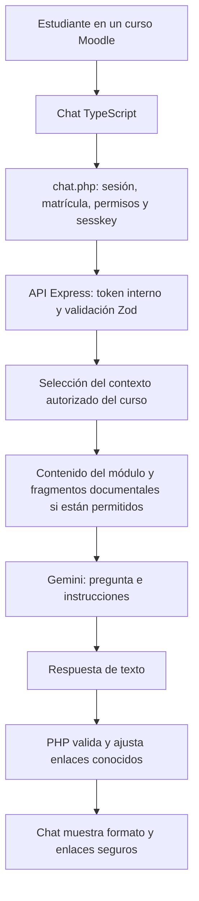

# Tutor IA de Gestión22: funcionamiento, paquetes, contenido y mantenimiento

Documento basado en el código del proyecto revisado el **20 de noviembre de 2026**. Describe la implementación existente; no es una descripción genérica de Gemini. Las versiones indicadas provienen de los archivos `package-lock.json` y la configuración local, no de una consulta al proveedor. No incluye claves ni contraseñas.

## 1. Qué es el tutor

El tutor es un chat integrado en Moodle que envía preguntas a **Google Gemini** y presenta sus respuestas al estudiante. Moodle controla quién puede usarlo y qué contenido del curso puede acompañar la consulta.

No hay un modelo entrenado desde cero por este proyecto ni un modelo de lenguaje ejecutándose en el computador local. Lo local es Moodle, la interfaz, el servidor intermediario y la biblioteca documental. La generación de respuestas ocurre en el servicio externo de Google y requiere internet y una clave válida.

La configuración local y el valor predeterminado del código indican el modelo **`gemini-3.5-flash-lite`**. Esto identifica lo configurado; esta revisión documental no comprobó la disponibilidad del modelo ni realizó una consulta de pago.

La plantilla `plantilla-moodle/` creada para reutilizar el diseño **no incluye automáticamente este tutor ni su API**. El tutor pertenece al complemento `public/local/gestion22tutor/` y al servicio `gestion22-ai-api/` del proyecto original.

## 2. Recorrido completo de una pregunta



1. El estudiante escribe una pregunta o pulsa **Preguntar al Tutor IA** en una actividad.
2. El botón de una actividad prepara una pregunta; el estudiante debe revisarla y pulsar **Enviar**. No se envía automáticamente el formulario de práctica.
3. El navegador hace un POST al endpoint de Moodle `/local/gestion22tutor/chat.php`, con `courseid`, `question` y `sesskey`. Si corresponde, añade `activityid` y `concept`.
4. PHP verifica sesión, matrícula activa, capacidad de uso, estado del complemento y acceso al módulo. El permiso `module1Allowed` se calcula en el servidor; no se acepta como decisión del navegador.
5. PHP envía JSON a `http://gestion22-ai:3001/api/chat`, autenticado mediante la cabecera `x-internal-token`.
6. Express valida los campos y selecciona el contexto mediante el ID de curso autorizado.
7. Se construyen las instrucciones para esa solicitud: reglas generales, contexto introductorio y, cuando corresponde, contenido del Módulo 1 y extractos de la biblioteca.
8. El SDK de Google solicita la respuesta a Gemini.
9. La API devuelve el texto. PHP comprueba el contrato de respuesta y puede reemplazar el enlace del video introductorio conocido por la sección local accesible del curso.
10. El frontend presenta la respuesta con un subconjunto de Markdown seguro.

## 3. Componentes y responsabilidades

| Componente | Ubicación | Función |
|---|---|---|
| Interfaz del chat | `public/local/gestion22tutor/ts/chat.ts` | Panel flotante, mensajes, envío, accesibilidad y estado de espera. |
| Cliente HTTP | `public/local/gestion22tutor/ts/api.ts` | POST a Moodle, validación de respuesta, timeout y mensajes de error. |
| Formato de respuestas | `public/local/gestion22tutor/ts/format.ts` | Párrafos, listas, énfasis, código y enlaces sin ejecutar HTML del modelo. |
| Apariencia del tutor | `public/local/gestion22tutor/styles.css` | Estilos del chat. Es independiente del CSS del tema Aula Verde. |
| Integración en Moodle | `public/local/gestion22tutor/classes/local/hook_callbacks.php` | Carga el chat y su CSS en páginas de cursos autorizados. |
| Intermediario PHP | `public/local/gestion22tutor/chat.php` | Autenticación, autorización, límite de solicitudes y conexión interna. |
| API de IA | `gestion22-ai-api/src/index.ts` | Endpoint Express, instrucciones, llamada a Gemini y reintentos. |
| Contexto por curso | `gestion22-ai-api/src/course-context.ts` | Carga y valida la introducción oficial y la asociación de cursos. |
| Contexto del módulo | `gestion22-ai-api/src/module1-context.ts` | Valida actividades e incorpora el contenido estructurado. |
| Recuperación documental | `gestion22-ai-api/src/module1-library.ts` | Selecciona fragmentos por coincidencia de palabras. |
| Indexador de documentos | `gestion22-ai-api/scripts/build-module1-library.mjs` | Extrae texto de PDF e imágenes y genera el índice JSON. |
| Acceso y revisión | `public/local/gestion22tutor/classes/local/module1_access.php` | Controla asociación, permisos y aprobación del contenido por hash. |

El archivo `gestion22-ai-api/src/index.php` existe, pero **no es el servidor de IA que inicia Docker**. El proceso activo definido por el paquete ejecuta `src/index.ts` mediante `tsx`.

## 4. Paquetes y versiones

### Backend Node.js

Versiones resueltas en `gestion22-ai-api/package-lock.json`. El rango de `package.json` permite otras versiones compatibles al regenerar el lock; `npm ci` usa las resueltas.

| Paquete | Versión resuelta | Para qué se utiliza |
|---|---|---|
| `@google/genai` | `1.52.0` | SDK para llamar a `ai.models.generateContent`. |
| `express` | `5.3.0` | Servidor HTTP, rutas y recepción de JSON. |
| `zod` | `4.6.7` | Validación de preguntas, actividades, contextos e índice documental. |
| `pdfjs-dist` | `6.5.438` | Lectura de PDF, extracción de texto y renderizado para OCR. |
| `tesseract.js` | `7.0.0` | Reconocimiento de texto en imágenes y PDF escaneados. |
| `@tesseract.js-data/spa` | `1.0.0` | Datos lingüísticos españoles utilizados por Tesseract. |
| `@napi-rs/canvas` | `1.1.0` | Lienzo para convertir páginas PDF a imágenes antes del OCR. |
| `tsx` | `4.23.15` | Ejecuta TypeScript directamente en Node. |
| `typescript` | `5.9.3` | Comprobación estática de tipos. |
| `@types/node` | `22.20.5` | Tipos de Node para desarrollo. |
| `@types/express` | `5.0.6` | Tipos de Express para desarrollo. |

`tesseract.js` y los datos `spa` están declarados en `devDependencies`, porque el OCR se realiza al preparar la biblioteca, no en cada pregunta. El Dockerfile actual ejecuta `npm ci` sin excluir dependencias de desarrollo.

**Detalle de mantenimiento:** el indexador importa directamente `@napi-rs/canvas`, pero no está declarado como dependencia directa en `package.json`; aparece como dependencia transitiva en el lock. Conviene declararlo explícitamente si se mantiene este proceso de indexación, para que no dependa de cambios de otros paquetes.

También se usan módulos incluidos con Node, como `node:fs` para archivos y `node:crypto` para SHA-256. No necesitan instalación separada.

### Frontend y Moodle

- El paquete `public/local/gestion22tutor/package.json` declara **TypeScript `5.9.3`** como dependencia de desarrollo.
- El frontend se compila a módulos **AMD**, cargados por Moodle. No usa React, Vue ni un framework de chat adicional.
- Se utiliza `fetch`, `AbortController` y la API DOM del navegador.
- PHP utiliza las funciones nativas de Moodle: sesión, capacidades, matrícula, formularios, configuración y cliente `curl`.
- La experiencia de videos carga el SDK de Vimeo desde `https://player.vimeo.com/api/player`; no es un paquete npm del chat ni aporta transcripciones a Gemini.
- Algunas pruebas de navegador utilizan Playwright como herramienta opcional; no es una dependencia necesaria para atender preguntas.

### Entorno

- Moodle del repositorio: **5.3+**, build **20261030**.
- Imagen del backend: **`node:22-alpine`**.
- Según la configuración local del proyecto, Moodle utiliza PHP 8.3 y MariaDB 11.4.
- Puerto interno de la API: **3001**. Moodle local se abre en **http://localhost:8080**.

## 5. Qué “diccionario” usa

Hay que distinguir cuatro elementos:

| Elemento | Existe | Explicación |
|---|---|---|
| Diccionario médico externo o glosario clínico independiente | No identificado en el código revisado | No hay una API de terminología, ontología o diccionario médico dedicado conectado al tutor. |
| Conocimiento lingüístico del modelo | Sí | Lo aporta Gemini como modelo externo; el proyecto no define su vocabulario interno ni sus datos de entrenamiento. |
| Datos españoles para OCR | Sí | `@tesseract.js-data/spa` permite a Tesseract reconocer texto en español. No verifica la exactitud clínica. |
| Lista de palabras comunes excluidas de búsqueda | Sí | Filtro pequeño definido en `module1-library.ts`, descrito a continuación. |

La lista efectiva de palabras excluidas es:

```text
que, del, los, las, una, con, por, para, como, sobre, son, este, esta
```

`del` aparece dos veces en el array original, sin cambiar el resultado.

El buscador normaliza tanto la pregunta como los fragmentos:

1. Descompone Unicode y elimina marcas de acentuación.
2. Convierte el texto a minúsculas.
3. Extrae secuencias `[a-z0-9]` de al menos tres caracteres.
4. Elimina repeticiones y las palabras comunes de la lista.

Por ejemplo, **“¿Qué función tiene la epidermis?”** queda aproximadamente en `funcion`, `tiene`, `epidermis`. `que` se excluye y `la` no cumple la longitud mínima.

No hay expansión de sinónimos, lematización ni diccionario especializado. Dos términos clínicamente equivalentes pueden no coincidir si se escriben de forma diferente. Tampoco se usan embeddings o una base vectorial.

Los archivos `lang/es/local_gestion22tutor.php` y `lang/en/local_gestion22tutor.php` son diccionarios de **textos de interfaz de Moodle**, no bases de conocimiento de la IA.

## 6. De dónde obtiene el contenido

### A. Introducción oficial del curso

Archivo: `gestion22-ai-api/data/course-contexts/heridas-avanzadas.json`.

Contiene información estructurada de bienvenida, recursos, evaluación, soporte, procedencia y datos no proporcionados. Tener la URL de un recurso no significa que el tutor haya descargado o leído ese recurso.

La asociación local está en `gestion22-ai-api/config/course-bindings.local.json`:

```json
"courses": {
  "2": "gestion22-heridas-avanzadas"
}
```

Solo el curso local 2 recibe ese contexto. Sin archivo de asociaciones configurado no hay asociación automática. El título del curso no se usa para adivinar el contenido.

El esquema valida los enlaces oficiales HTTPS y el Vimeo de presentación permitido. El campo `moodleOrigin` forma parte de la configuración, pero el registro de contexto del backend selecciona por `courseId`; ese campo no actúa por sí solo como una verificación de origen de cada petición.

### B. Contenido estructurado del Módulo 1

Archivo: `gestion22-ai-api/data/module1.json`.

Incluye videos identificados, capas y funciones de la piel, riesgos, zonas de valoración, observaciones, checklist, prevención, caso ficticio, decisiones del caso, cuestionario formativo, material complementario y `tutorContexts`.

Los seis identificadores permitidos son:

| ID | Contenido |
|---|---|
| `anatomy` | Capas, componentes y funciones de la piel. |
| `risks` | Factores de riesgo y asociaciones educativas. |
| `assessment` | Valoración sistemática y zonas de atención. |
| `checklist` | Registro educativo y componentes del checklist. |
| `case` | Repaso de un caso ficticio con decisiones predefinidas. |
| `practice` | Autoevaluación formativa. |

El backend incorpora **todo el JSON del módulo** cuando se permite, y añade el repaso específico de `tutorContexts` si se identifica una actividad. `concept` debe coincidir con `activityId`; es una categoría validada, no un glosario libre.

### C. Biblioteca documental extraída

Archivo: `gestion22-ai-api/data/module1-library.json`.

Inventario encontrado durante esta revisión:

| Archivo fuente | Tipo | Páginas con texto / total |
|---|---|---|
| `Dermatitis atópica severa en la infancia.pdf` | PDF | 8 / 8 |
| `Guia_Valoracion_Integridad_Cutanea_Oficio.pdf` | PDF | 1 / 1 |
| `M1_A.pdf` | PDF | 17 / 17 |
| `M1_B.pdf` | PDF | 20 / 20 |
| `M1_C.pdf` | PDF | 27 / 27 |
| `Manejo del neonato con piel frágil.pdf` | PDF | 13 / 13 |
| `anatomia-piel.png` | Infografía | 1 / 1 |
| `Checklist de evaluación de la piel.png` | Infografía | 1 / 1 |
| `Prevención desde el ingreso del paciente.png` | Infografía | 1 / 1 |
| `Tabla Resumen_ Factores que afectan la integridad Cutánea.png` | Infografía | 1 / 1 |

Son **6 PDF con 86 páginas**, más **4 infografías**, equivalentes a 90 entradas de página con texto. “Con texto” significa que el extractor obtuvo contenido; no acredita que la extracción sea íntegra ni que el OCR sea correcto.

Cada documento registra título, nombre del archivo, hash SHA-256, total de páginas y textos por página. No se usa una base documental remota ni una descarga de recursos de Moodle en cada pregunta.

## 7. Cómo se construye y consulta la biblioteca

### Preparación del índice

El script `scripts/build-module1-library.mjs`:

1. Lee los PDF de `public/local/gestion22tutor/pdf/`.
2. Extrae texto con PDF.js.
3. Si una página tiene menos de 200 caracteres extraídos, la renderiza a escala 2 y ejecuta OCR en español. Conserva el OCR cuando produce más texto que la extracción inicial.
4. Ejecuta OCR en las cuatro imágenes enumeradas explícitamente en el script.
5. Calcula los hashes de los archivos y escribe `data/module1-library.json`.

El parámetro `--images-only` conserva los documentos PDF del índice existente y reconstruye las imágenes. Las imágenes nuevas no se incorporan automáticamente: hay que añadirlas a la lista del script.

### Búsqueda en cada consulta

La función `libraryInstruction`:

1. Exige que el `contextId` de la biblioteca coincida con el contexto del curso.
2. Divide cada página en fragmentos de hasta **1.800 caracteres**, avanzando **1.400 caracteres**; puede haber 400 caracteres de solapamiento.
3. Normaliza las palabras de la pregunta, del texto y del título.
4. Da **1 punto** por término de la consulta presente en el fragmento y **2 puntos adicionales** si aparece en el título del documento. No cuenta la frecuencia de repetición.
5. Descarta fragmentos con puntuación cero, ordena y toma los **8 mejores**.
6. Añade a las instrucciones el inventario de documentos y esos fragmentos, con título, página, texto y puntuación.

Esto es una recuperación documental **léxica** que complementa la generación: puede describirse como una forma básica de RAG, sin búsqueda semántica ni embeddings. No corresponde afirmar que el código actual carece de toda recuperación documental.

Si no hay coincidencias, la lista de fragmentos queda vacía; aun así puede acompañarse el inventario y el contenido estructurado permitido. No existe un bloqueo automático que garantice que Gemini solo responda afirmaciones presentes en los fragmentos.

## 8. Instrucciones y parámetros de Gemini

Las instrucciones generales están en `SYSTEM_INSTRUCTION`, dentro de `gestion22-ai-api/src/index.ts`. Piden al modelo:

- Responder en español claro, profesional y cercano.
- Explicar conceptos de manera sencilla, con ejemplos y pasos.
- Proponer actividades formativas y casos ficticios.
- No dar respuestas de evaluaciones oficiales.
- No inventar referencias ni afirmar acceso a archivos no adjuntos.
- Reconocer lagunas y recomendar al tutor humano cuando corresponda.
- No tomar decisiones clínicas para pacientes reales.

Las instrucciones adicionales indican usar los datos introductorios oficiales, no inventar enlaces o identidades, citar título y página cuando se usan extractos y no seguir instrucciones contenidas dentro de los documentos.

| Parámetro | Valor en el código |
|---|---|
| Modelo | `GEMINI_MODEL` o, si no existe, `gemini-3.5-flash-lite`. |
| Temperatura | `0.4`. |
| Límite de salida | `maxOutputTokens: 1000`. Son tokens, no 1.000 palabras. |
| Intentos máximos | 3 en total. |
| Errores reintentados | 429 y 503 del proveedor. |
| Esperas | 2 segundos antes del segundo intento y 4 antes del tercero. |

No hay herramientas de búsqueda web, ejecución de código, navegación de archivos libre ni entrenamiento o ajuste fino configurados en la llamada. El modelo recibe la pregunta actual en `contents` y las instrucciones construidas en `systemInstruction`.

## 9. Historial, datos y privacidad

**La conversación visible no es memoria del modelo.** El chat conserva los mensajes en el DOM de la página, pero cada llamada envía únicamente la pregunta actual y los contextos del servidor. No se reenvían automáticamente las preguntas y respuestas anteriores. Recargar la página elimina ese historial visual.

El flujo de solicitud no implementa una tabla de conversaciones ni guarda preguntas en una base de datos propia. Hay registros operativos de curso consultado y errores. No se debe interpretar esto como una garantía sobre retención de datos del proveedor externo o de toda la infraestructura.

| Trayecto | Datos enviados |
|---|---|
| Navegador → Moodle | ID del curso, pregunta, sesskey y actividad/concepto opcionales; también la cookie normal de sesión Moodle. |
| Moodle → API interna | ID del curso, pregunta, permiso `module1Allowed`, actividad/concepto opcionales y token interno en cabecera. |
| API → Google | Pregunta, modelo, parámetros e instrucciones con los contextos y fragmentos seleccionados. La clave autentica la llamada. |

Nombre, correo, ID del estudiante, contraseña y cookie Moodle no se añaden como campos a la solicitud de generación. **Si el estudiante escribe datos personales en su pregunta, ese texto sí puede llegar a Google:** hay avisos e instrucciones, pero no un anonimizador automático en el código revisado.

Los formularios de valoración y checklist no se adjuntan automáticamente al chat. El progreso de la experiencia del Módulo 1 se almacena por separado en `localStorage`, con una clave asociada a sitio, usuario y curso; no constituye historial conversacional ni una nota oficial.

El proveedor de privacidad del plugin declara el envío de preguntas a un servicio externo en `classes/privacy/provider.php`. La retención y el tratamiento que Google aplique dependen del servicio y de la cuenta contratada; no se han verificado en esta revisión del repositorio.

## 10. Autorización y límites técnicos

- Solo POST en `chat.php`; una petición GET recibe 405.
- Usuarios anónimos o invitados no pueden consultar.
- Se verifica sesskey contra solicitudes no autorizadas desde otras páginas.
- Se requiere matrícula activa y `local/gestion22tutor:use` en el curso; la portada se excluye.
- El complemento debe estar habilitado en la configuración de Moodle.
- PHP permite preguntas de 3 a 2.000 caracteres, con máximo adicional de 8.000 bytes.
- PHP limita a **20 solicitudes por minuto por sesión Moodle**, no por cuenta global ni por toda la infraestructura.
- Express limita el JSON a **16 KB** y exige el token interno.
- La conexión PHP a la API tiene timeout de conexión de **5 segundos** y total de **90 segundos**.
- El navegador espera **95 segundos** con la configuración actual.
- La dirección interna está fijada en PHP; no procede del navegador y no se siguen redirecciones.
- Las respuestas no se insertan como HTML libre. El formateador crea nodos DOM y permite enlaces HTTP, HTTPS y `mailto`, sin credenciales embebidas.

La capacidad `local/gestion22tutor:manage` corresponde de forma predeterminada a profesores con edición y gestores; se usa para revisión del módulo. La capacidad de uso está declarada para estudiantes, profesores y gestores, pero el código también exige matrícula activa.

## 11. Revisión docente y acceso al Módulo 1

Además de la asociación del backend, Moodle necesita la configuración `module1context_IDCURSO = gestion22-heridas-avanzadas`.

`module1_access.php` calcula el hash del archivo de contenido y verifica dos ajustes por curso:

- `module1reviewed_IDCURSO`.
- `module1reviewhash_IDCURSO`.

Si no existe una aprobación que coincida con el hash actual, exige capacidad de gestión. Por ello un docente autorizado puede acceder a la vista previa antes de la publicación, mientras un estudiante mantiene el soporte introductorio sin recibir ese módulo.

La pantalla de revisión es `/local/gestion22tutor/review_module1.php?courseid=2` para el curso local asociado.

**Límite del control actual:** el hash de aprobación cubre el JSON del módulo, no el archivo independiente `module1-library.json` ni las instrucciones del servidor. Modificar solo la biblioteca no invalida automáticamente esa aprobación. Sus extractos y su OCR requieren revisión aparte.

## 12. Evaluación, citas y límites de confianza

Los ejercicios interactivos y decisiones correctas del caso están predefinidos en los contenidos y el frontend. Gemini ayuda a repasar; no determina la respuesta correcta oficial ni modifica el libro de calificaciones.

La API responde actualmente:

```json
{
  "success": true,
  "courseId": 2,
  "answer": "Texto generado por el tutor",
  "sources": [],
  "grounded": false,
  "needsHumanTutor": false
}
```

- `sources: []` no significa que nunca se usen documentos: significa que no se devuelve una lista estructurada de citas verificadas.
- `grounded: false` se mantiene incluso con extractos adjuntos, porque no se comprueba automáticamente cada afirmación.
- Las citas de título y página, cuando aparecen, son parte del texto generado y pueden requerir comprobación.
- `needsHumanTutor` está fijado a `false` en el backend: no existe un clasificador automático de derivación, aunque las instrucciones permiten recomendar a un tutor humano en el texto.
- Las restricciones de las instrucciones reducen riesgos, pero no son una garantía técnica de que cada respuesta cumpla las reglas.
- No hay transcripciones incorporadas de los videos ni análisis de su audio. El SDK Vimeo sirve para reproducción y seguimiento del progreso local.

## 13. Configuración necesaria

Se documentan los nombres de las variables, sin sus secretos:

| Variable | Dónde se utiliza | Finalidad |
|---|---|---|
| `GEMINI_API_KEY` | Backend | Clave de Google. Nunca debe enviarse al frontend. |
| `GEMINI_MODEL` | Backend | Selecciona el modelo. |
| `INTERNAL_API_TOKEN` | Moodle y backend | Debe coincidir para autenticar el enlace interno. |
| `PORT` | Backend | Puerto de escucha, por defecto 3001. |
| `COURSE_CONTEXT_BINDINGS_FILE` | Backend | Ruta del archivo de asociaciones explícitas. |
| `MODULE1_CONTENT_FILE` | Backend | Ruta del JSON del módulo. |
| `GESTION22_MODULE1_CONTENT_FILE` | Moodle | Ruta del mismo contenido para acceso, presentación y hash de revisión. |

El `.env` raíz suministra el token a Moodle. `gestion22-ai-api/.env` suministra la configuración del servicio de IA. **El código usa `process.env`; no carga `.env` con una librería dotenv.** Docker Compose lo inyecta mediante `env_file` y `environment`. Ejecutar `npm start` directamente requiere preparar esas variables en el entorno.

Según `compose.yaml`, el archivo local de asociaciones se monta en `/app/config/course-bindings.local.json`; el módulo se monta en `/app/data/module1-content.json` para la API y en `/var/www/gestion22-content/module1.json` para Moodle. La biblioteca documental, en cambio, se copia dentro de la imagen al construirla.

La configuración se carga al iniciar el backend. Cambiar contextos o asociaciones exige reiniciarlo; cambiar archivos copiados en la imagen exige reconstruirla.

## 14. Cómo modificarlo

| Cambio deseado | Archivo o lugar |
|---|---|
| Tono, reglas generales o límite de salida | `gestion22-ai-api/src/index.ts`. |
| Modelo | `GEMINI_MODEL` del entorno de la API. |
| Bienvenida, evaluación o soporte oficiales | `gestion22-ai-api/data/course-contexts/heridas-avanzadas.json`. |
| Asociación de un curso Moodle con un contexto | `gestion22-ai-api/config/course-bindings.local.json`. |
| Contenidos y repasos de las actividades | `gestion22-ai-api/data/module1.json`. |
| Palabras comunes, tamaño de fragmento o puntuación | `gestion22-ai-api/src/module1-library.ts`. |
| PDF fuente | `public/local/gestion22tutor/pdf/`; después reconstruir el índice. |
| Imágenes para OCR | `public/local/gestion22tutor/images/` y lista del indexador. |
| Diseño del chat | `public/local/gestion22tutor/styles.css`. |
| Textos y comportamiento del chat | `public/local/gestion22tutor/ts/chat.ts`. |
| Formato de las respuestas | `public/local/gestion22tutor/ts/format.ts`. |
| Permisos de uso o gestión | Roles/capacidades de Moodle y `db/access.php`. |

Para otro curso, no basta con copiar el CSS o cambiar el título: hay que preparar su contexto y asociarlo explícitamente. La biblioteca y el acceso del Módulo 1 están especializados en `gestion22-heridas-avanzadas`; admitir bibliotecas y módulos distintos por curso requiere generalizar esa selección y los controles PHP.

### Reconstruir la biblioteca

Desde `gestion22-ai-api/`, con dependencias instaladas:

```powershell
npm.cmd ci
npm.cmd run index:module1
```

Revisa el OCR y las páginas obtenidas. Después, desde la raíz:

```powershell
docker compose up -d --build gestion22-ai
```

Reconstruir el índice no vuelve a entrenar Gemini: cambia los extractos que el sistema puede adjuntar a futuras consultas.

### Compilar cambios del frontend

Desde `public/local/gestion22tutor/`:

```powershell
npm.cmd ci
npm.cmd run build
npm.cmd run typecheck
npm.cmd test
```

No edites directamente `amd/build/chat.min.js` ni el compilado de actividades. Son salidas de TypeScript; se distribuyen también sus mapas. El sufijo `.min.js` responde a la convención de Moodle, pero `tsc` no minifica por sí solo.

Después de cambiar los recursos del plugin, purga las cachés de Moodle:

```powershell
docker compose exec -T --user www-data web php admin/cli/purge_caches.php
```

## 15. Diagnóstico y pruebas disponibles

Estos comandos están documentados para mantenimiento; **no se ejecutaron como parte de la redacción de este documento**.

Desde la raíz:

```powershell
docker compose ps
docker compose up -d --build gestion22-ai
docker compose logs --tail=80 gestion22-ai
```

`GET /health` comprueba que el proceso Express responde. No comprueba credenciales válidas de Gemini, cuota disponible ni calidad de las respuestas. El contenedor inicia si están presentes las variables requeridas, pero la consulta al proveedor puede fallar después.

Desde `gestion22-ai-api/`:

```powershell
npm.cmd run check
npm.cmd test
```

Hay pruebas de contexto por curso, validación de actividades y recuperación de biblioteca en `gestion22-ai-api/tests/`. El plugin dispone de pruebas AMD, formato, navegador e integración PHP dentro de `public/local/gestion22tutor/tests/`; algunas pruebas de integración o navegador hacen llamadas reales a Gemini y consumen cuota.

| Síntoma | Qué revisar |
|---|---|
| No aparece Tutor IA | Complemento habilitado, curso distinto de portada, matrícula activa, capacidades y caché. |
| 401 | Sesión Moodle ausente o token interno incorrecto, según el tramo donde ocurra. |
| 403 | Sesskey, matrícula, permisos, acceso al módulo o sesión vencida. |
| 429 | Límite por sesión en PHP; el proveedor también puede originar saturación antes de que el backend la traduzca. |
| 503 | Servicio temporalmente ocupado, token no configurado en PHP o fallos temporales del proveedor. |
| 502 | API inaccesible, respuesta inválida, timeout o error de generación. |
| Respuestas genéricas | Asociación del curso, contenido cargado, revisión docente y coincidencias léxicas. |
| OCR deficiente | Calidad del documento, extracción por página y revisión manual del índice. |
| No recuerda lo anterior | Comportamiento actual: no se envía historial al modelo. |

No publiques logs o archivos `.env` sin revisarlos: pueden contener información operativa o mensajes del proveedor.

## 16. Discrepancias detectadas en la documentación previa

Para interpretar el proyecto, el código actual tiene prioridad frente a descripciones antiguas:

- Algunos README dicen “no hay RAG”. Actualmente sí existe recuperación de fragmentos en `module1-library.ts`, aunque no es vectorial y `grounded` sigue siendo `false`.
- Algunas descripciones indican respuestas como texto sin formato; actualmente existe un formateador de un subconjunto de Markdown construido con nodos seguros.
- El campo `documents: []` del contexto introductorio sigue vacío, pero la biblioteca se carga desde un archivo separado. Ese campo vacío no significa que no haya PDF indexados.
- Las versiones informativas no coinciden: `package.json` indica `0.1.0`, `/health` indica `0.3.0` y el plugin Moodle declara `0.2.0-alpha`. Son etiquetas de componentes distintos y no demuestran por sí solas el estado operativo.
- La revisión por hash del módulo no cubre automáticamente la biblioteca OCR.

## 17. Archivos que conviene conservar para trasladar el tutor

Necesitas el complemento Moodle completo, incluido el JavaScript AMD compilado, y el backend con su código, lock de dependencias, contextos, índice documental y Dockerfile. Debes configurar las variables de entorno y asociaciones para el nuevo sitio, sin publicar secretos ni reutilizar ciegamente el ID local 2.

Conserva también los PDF e imágenes fuente si quieres poder reconstruir el índice. No copies la base de datos ni los archivos de estudiantes solo para trasladar el tutor. El código del tutor no forma parte del paquete de diseño Aula Verde.

Este documento describe y señala límites del estado actual. No cambia el tutor, su configuración, las aprobaciones docentes ni sus dependencias.
